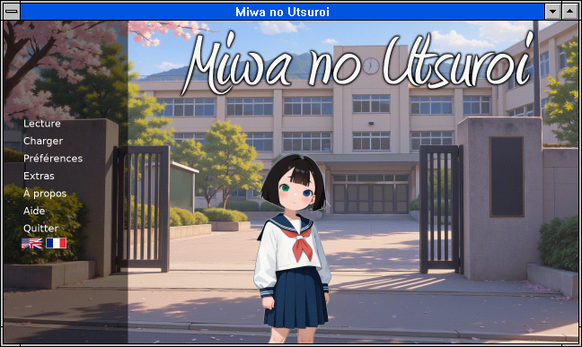

# minirenpy



A from-scratch engine that runs (simple) Ren'Py visual novels on **Windows 3.1x +
Win32s** and on **DOS**, written in C89 and built with OpenWatcom 2.0.

The target machine is a Pentium III:
- Shared: 64MiB of RAM
- DOS: A VBE 2.0 video card and a Sound Blaster-compatible card.
- Win32: Windows display driver and anything with a waveOut driver.

It is not a port of Ren'Py and shares no code with it.
It reads the same `.rpy` files - the script, the screen language, the styles,
the translation catalogues, and reimplements the subset of the engine those files
actually use, reading Ren'Py 8.5.3's own source for every behaviour so that the
original and this one agree on the details rather than on the documentation.

The same Win32 binary runs on Windows NT 3.1, Win32s on 3.1/3.11, 95/98, NT 4
and Windows 10 (the PE subsystem version is 3.10, which is the oldest Win32
there is).
The DOS build runs on MS-DOS 7.1, FreeDOS, and DOSBox-X, with DOS/32A or CauseWay
bound into the executable.

---

## What's in the tree

| path | what it is |
|---|---|
| `src/` | the engine: ~60 translation units, C89, no dependency on the host beyond its own platform seam |
| `tools/` | build-time Python (archive, fonts, cutscene stand-ins) and host-side C utilities |
| `tools/harness/` | the test suite: ~80 self-contained host programs that link the real engine sources |
| `tools/hostshim/` | just enough of `windows.h` and friends to compile engine files with gcc on Linux |
| `probe/` | small DOS/Win32 programs that answer a question *on the target*, where the host cannot |
| `libs/` | vendored zlib, libpng, minimp3, pl_mpeg, xvidcore |
| `Makefile` | the Win32s build |
| `Makefile.dos` | the DOS build (DOS/32A); `Makefile.cw` is the same with five values changed, for CauseWay |
| `mrpyini.txt` | every setting and environment variable the shipped engine reads |

### The engine's own layout

| file | role |
|---|---|
| `main.c` | frame loop, startup order, game-dir discovery - portable |
| `plat.h` | the seam between the engine and the machine |
| `platw32.c` / `platdos.c` | the window and message pump / int 9 keyboard, int 33h mouse, the PIT |
| `present.c` / `presdos.c` | GDI output and the letterbox / a VBE linear framebuffer, plus a software pointer |
| `vbe.c`, `vbedos.c` | VESA mode decoding, and the mode-choice policy |
| `wave.h`, `wavew32.c`, `wavedos.c` | the sound seam; waveOut; Sound Blaster 1/2/Pro/16 and ESS, with DMA |
| `audio.c`, `mp3impl.c`, `sbconv.c` | the mixer (portable), minimp3, and conversion for pre-SB16 cards |
| `gfx.c`, `pack.c`, `blendmmx.c`, `yuvmmx.c` | surfaces, alpha blit, pixel packing, the two MMX kernels |
| `vfs.c`, `png.c`, `image.c` | the MRPK archive; libpng decode; the name registry and LRU cache |
| `lex.c`, `parse.c`, `expr.c`, `interp.c` | `.rpy` to logical lines, to statements, to execution |
| `scene.c`, `font.c`, `ui.c` | the display list, placement and transitions; the glyph atlas; the dialogue box |
| `slang.c`, `slparse.c`, `style.c`, `slrender.c` | the screen language: tables, parser, styles, layout and hit-testing |
| `movie.c`, `viddec.c`, `avi.c` | cutscene timing, and codec selection |
| `tl.c`, `md5.c` | the translation catalogue and Ren'Py's identifier digest |
| `persist.c`, `save.c` | persistent data; save slots |

---

## Building

The build host is Linux with the **Linux-hosted OpenWatcom 2.0** tools
(`wcc386` emits `.o`, not `.obj`, which is why the object lists say so).
Python 3 is needed for the data targets, and `ffmpeg` only if a game has video
cutscenes.

zlib, libpng and xvidcore are built from source by the makefile, so they match
the register calling convention (`-6r`) the engine uses.

### Windows (Win32s / 9x / NT / 10)

```sh
export WATCOM=/path/to/WATCOM
export PATH=$WATCOM/binl:$PATH
export INCLUDE=$WATCOM/h:$WATCOM/h/nt

wmake            # mrpy.exe
wmake libs       # zlib, libpng, xvidcore (done automatically if missing)
wmake data       # bake fonts, derive cutscene stand-ins, pack the archive
wmake pak        # generate the .pak game archive (a renpy 'game' directory + font data)
wmake dist       # stack-probe, UPX, and a dist/ with exe + pak + ini
wmake run        # under Wine, for a quick look
wmake clean
```

`wmake data` is three steps and the order matters: `fonts` (the glyph atlases,
which are build output and live in the game directory), `cutscenes` (first
frame plus soundtrack for each `movie_cutscene`), then `pak`.

### DOS

```sh
export WATCOM=/path/to/WATCOM
export PATH=$WATCOM/binl:$PATH
export INCLUDE=$WATCOM/h          # note: no $WATCOM/h/nt here

wmake -f Makefile.dos             # mrpydos.exe and modes.exe
wmake -f Makefile.dos game
wmake -f Makefile.dos modes       # MODES.EXE, the VBE mode lister
wmake -f Makefile.cw  game        # the same objects, linked against CauseWay
```

The extender is bound into the executable, so what ships is one file that
needs nothing on the path. `MODES.EXE` links only `vbe.c` and `vbedos.c`, and
doubles as the smallest possible check that the toolchain, the extender, the
DPMI calls and the real-mode scratch buffer all work: it prints every mode the
BIOS offers and, for each one refused, the reason.

### Building a different game

The per-game makefiles are four lines - two values and `!include Makefile` -
because the engine binary does not vary:

```sh
wmake -f Makefile.othergame data     # ../othergame/game -> other.pak
```

Only the `data` target's output differs. `game/` is a symlink to the Ren'Py
game directory being packed.

---

## Running

Put the exe, the `.pak` and (optionally) `mrpy.ini` in one directory.

```ini
[minirenpy]
pak=mrpy.pak
width=640
height=360
```

Everything is optional: the built-in defaults are a working configuration.
Nothing in the ini mirrors the game's `gui.rpy` - the engine reads all of that
from the game's own `.rpy` files, which is where a Ren'Py game says it. The
ini holds only what cannot come from the game data: how the game data is found
and how it is shown.

`log.txt` is written next to the exe on every run and records which settings
were read, which video mode and sound card were chosen, and why. It is the
first thing to look at when something is wrong.

**`mrpyini.txt` is the complete reference** - every key, its default, its
range, and the one case where changing it is worth it. The settings worth
knowing about here:

- `width` / `height` - the window's client area. The stage is always 1280x720
  and is scaled to fit, so a bigger window costs speed and a smaller one costs
  detail; neither reflows anything.
- `fps=N` - a ceiling on how often the screen is drawn, 60 by default.
  Nothing in the engine is frame-driven, so this costs smoothness and never
  pacing. `fps=30` leaves a slow machine more time for sound.
- `bilinear=1`, `dib16=`, `dither=0` - the final scaling and pixel-format
  passes (Windows).
- `depth=`, `vbemode=`, `truecolour=1`, `border=` - video mode choice (DOS).
- `movie=0` - refuse video cutscenes and hold the first frame with its
  soundtrack instead, for a machine a particular file is too much for.
- `simd=0` - disable the MMX kernels. They are gated on CPUID and never used
  on a processor without MMX whatever this says; `simd=2` forces them, and is
  for a false negative only.
- `audiogain=`, `essnative=0`, `audiodither=0`, `audiotone=1` - the DOS sound
  path.

A handful of `MR_*` environment variables turn on profiling, layout dumps,
rollback traces, and starting at a named label (`MR_LABEL=`) or screen
(`MR_SCREEN=`). They make the engine slower and noisier and exist for looking
into a problem; `mrpyini.txt` section 5 lists them.

### What the target needs

**Windows:** a PIII 550MHz baseline, 64MiB free, two mouse buttons, any
waveOut driver, VGA or better. There are dithering paths for 4bpp and 8bpp
displays, autodetected; 16bpp or better is recommended.

**DOS:** the same CPU, 64MiB of XMS, ~300K conventional under VCPI
(HIMEM+EMM386) or ~100K under DPMI, a mouse driver, a VBE 2.0 card able to
give a 640x480x8 linear framebuffer, and a correct `BLASTER` variable.

SB16 avoids downsampling; SB1/SB2/SBPro and ESS1868 all work, the ESS in its
own 16-bit mode.

---

## The Ren'Py subset

The engine parses a game's real `.rpy` files. It reads a fixed list of them,
in Ren'Py's declaration order: `gui.rpy`, `options.rpy`, `screens.rpy`,
`script_declares.rpy`, `script.rpy`, `script_game.rpy`, plus everything under
`tl/<language>/`. An unrecognised statement is skipped with its file and line
in the log, rather than refused.

**Statements:** `label` (with `call`/`return`, and a call stack), `say` with
characters, `scene`, `show`, `hide` (with `at`, `behind`, `as`, `onlayer`,
`zorder`, and attribute sets), `with`, `jump`, `call`, `return`, `if`/`elif`/
`else`, `menu` with captions and `if` conditions on choices, `play`/`queue`/
`stop` on any channel, `window show`/`hide`, `pause`, `$` one-liners,
`python:`/`init python:` blocks (assignments, and no-argument `def`s that a
screen can call), `define`, `default`, `image`, `transform`, `style`,
`screen`, `show screen`/`hide screen`, `call screen`.

`while`, `translate` blocks in the script body and `layeredimage` are *not*
parsed - the first is unused by any game here, and translations are read from
`tl/<language>/` instead.

**Transitions:** `dissolve`, `fade`, `Fade(...)`, the whole `move` family
(`move`, `movein*`, `moveout*`) and `MoveTransition(...)` written longhand for
a non-stock duration. `im.Blur` on an image declaration.

**ATL:** `transform` blocks animate - `linear` and `ease` steps interpolate
placement *properties*, not resolved pixels, and `repeat` loops. Ren'Py's rule
that an integer position is pixels while a float is a fraction of the stage is
followed exactly, including the trap that `yalign 1` is one pixel from the top
and `yalign 1.0` is the bottom.

**Screen language**, end to end - parse, styles, layout, hover/click: `text`,
`hbox`/`vbox`/`fixed`/`grid`/`side`, `window`/`frame`, `button`/`textbutton`/
`imagebutton`, `bar`/`vbar`, `viewport`/`vpgrid`, `imagemap`/`hotspot`,
`add`, `timer`, `key`, `dismiss`, `transform`, `use` with arguments,
`transclude`, `for` over `range()` and list literals, `showif`, and `modal`.
Screens have real local scopes: `use` parameters, `for` variables and `$`
assignments inside a screen are scope-local, and a button's scope is captured,
so a `FileAction(slot)` written inside a loop still means the right thing when
it is clicked a frame later. `align` is expanded into pos and anchor, the way
Ren'Py's `set_yalign` does it.

**Actions and values:** `Start`, `MainMenu`, `Return`, `Quit`, `Jump`,
`Rollback`, `Skip`, `ShowMenu`, `Hide`, `NullAction`, `SetVariable`,
`ToggleVariable`, `SetScreenVariable`, `ToggleScreenVariable`, `Preference`,
`Play`/`Queue`/`Stop`, `MusicRoom`, `AudioPositionValue`, `Language`,
`Notify`, `QuickSave`/`QuickLoad`, and the file family -
`FileAction`, `FileSaveName`, `FileTime`, `FileScreenshot`, `FileLoadable`,
`FileDelete`, `FilePage`, `FilePageNext`/`Previous`, `FileCurrentPage`.

**Python** is a recursive-descent evaluator, not an interpreter: `or`/`and`/
`not`, the six comparisons, `+ - * / %`, unary minus, calls, string and
numeric literals, `True`/`False`/`None`, list literals and one-level list
comprehensions, `[name]` interpolation with `!t` for translation. The variable
store is flat and dotted names are keys, so `gui.text_size` and
`persistent.unlocked` are variables rather than attribute lookups. This is
enough for what a visual novel's `.rpy` actually contains, and not more.

**Text tags:** `{b}`, `{i}`, `{u}`, nested and counted, with `{{` for a
literal brace. An unknown tag is consumed and ignored.

**Also implemented:** save/load with thumbnails (256x144, 5-6-5, no encoder
needed), save pages and quick saves, rollback and rollforward including music
state, text history, seen-text tracking and the three skip modes, the
preferences screen with real volume and text-speed sliders, translations into
any language with Ren'Py's own md5 identifiers, persistent data, a jukebox,
and MPEG-1 and MPEG-4-in-AVI cutscenes.

### Known departures
- `Movie()` as a displayable is not implemented; `renpy.movie_cutscene()` is.
  A cutscene writes converted pixels straight into the presenter instead of
  going through the 1280x720 stage, which is the only way the target can run
  one at all.
- Video is MPEG-1 (MP2, program stream) or MPEG-4 Simple Profile (MP3, AVI).
  VP8 and H.264 at 720p are out of reach of a PIII, so a `.webm` falls back to
  its first frame plus soundtrack, for exactly the duration of the video.
- The dialogue window appears and disappears at once rather than over
  `config.window_show_transition`, and `config.window_auto_hide` is not
  implemented. Both would put a full-screen composite into exactly the
  transitions they were meant to decorate.
- A right-click ends a cutscene instead of opening the game menu, matching an
  observed Ren'Py run rather than its source.
- Fonts are prebaked atlases at the sizes the game's `gui.*_text_size` defines
  ask for, because GDI on 3.1 cannot antialias TrueType. CJK has one weight,
  so `{b}` and `{i}` around a kanji fall back to the regular glyph.
- `r` restores the window to its configured size. Ren'Py has no such binding;
  a drag-resize cannot otherwise be undone by hand.
- There is no text entry anywhere - no `WM_CHAR` handler - so a save-name
  input field is not available.

---

## How the engine works

**One thread, one loop.** `main.c` draws at most `fps` times a second and
otherwise sleeps, and that is the whole concurrency story: there is no
threading on Win32s worth having and none in DOS. `mr_plat_service` is called
from anywhere that might take a while, so the mixer keeps being fed during a
long decode or a modal drag.

**Nothing is frame-driven.** The typewriter runs off
`_preferences.text_cps`, transitions off elapsed milliseconds, and the mixer
off the sound card's own clock. The frame rate therefore buys smoothness and
can never make anything run at the wrong speed.

**The stage is 1280x720 whatever the window is**, and the window is a scaled
view of it. This is the single most important performance fact about the
engine: a full composite of the stage is about a third of a second on the
target, so anything per-frame has to avoid touching all of it. Partial frames
are load-bearing - the screen system asks "will this look different?" and
redraws only what will.

**The platform seam is three headers.** `plat.h` (window, clock, input),
`wave.h` (the sound sink) and the presenter. Everything above them is
portable and is compiled and tested on Linux with gcc; `platw32.c`,
`platdos.c`, `wavew32.c` and `wavedos.c` are the only files that know which
machine this is.

**A game is an archive.** `tools/mkpak.py` writes a flat MRPK file because
FAT 8.3 cannot hold `script_declares.rpy` or `miwa school biwa talk.png`; the
archive keeps the long names internally so the filesystem only ever sees
`MRPY.PAK`. `vfs.c` mounts it, and falls back to a loose directory when there
is none.

**The script becomes one statement array.** `lex.c` folds the file into
logical lines with indentation, `parse.c` turns those into statements and
resolves labels, and `interp.c` is a state machine over the array: it runs
until it hits something that waits (a line of dialogue, a transition, a
pause), and each frame asks whether that wait is over. Declarations sit
outside any label and are all run once up front, which is what Ren'Py's init
phase amounts to. The execution point is stored in a save **by name**, not by
index, so a save survives an edit to the script.

**Pictures go through one cache.** `image.c` keeps a name registry and an LRU
of decoded 32bpp surfaces; `scene.c` holds a display list of placed images per
layer and knows how to blend two of them for a transition. A dissolve starts
from what is actually on screen rather than from a re-render, which is the
only way it looks right when something was mid-animation.

**Audio is one mixer.** `audio.c` mixes 44.1kHz stereo from MP3 and WAV
sources across named channels (music, sound, the rhythm game's four hit
channels, and a movie's soundtrack), applies per-mixer volume and mute, and
hands frames to a sink. Verified against ffmpeg at 0.9994+ correlation. On
pre-SB16 cards `sbconv.c` converts and dithers down to 8-bit.

**Cutscenes are clocked by the sound card.** The picture is a function of how
much of the soundtrack the card says it has *played*, not of the wall clock:
audio, once started, cannot be hurried, and a gap in it is far worse than a
dropped frame. Frames whose moment has passed are decoded and discarded.

**MMX where it pays, CPUID-gated.** YUV-to-RGB conversion and sprite blending
have claude-written Watcom assembly kernels.
Both are behind a `have_simd()` that follows xvidcore's own detection.

---

## Tests

```sh
tools/harness/run.sh            # build and run everything
```

About eighty harnesses, each a single C file that links the real engine
sources against `tools/hostshim/` and gcc. They drive the actual code - the
parser, the interpreter, the screen layout, the mixer, the save format - and
the **exit code is the test**; `run.sh` prints a pass/fail count. They use the
fixtures in `tools/harness/`, never a game's script, and the suite runs with
no game and no archive mounted at all.

The host build cannot see everything, and the places it cannot are handled
rather than hidden:

- Watcom's codegen faults are invisible to any test because the answer is
  right either way (a hardware `div` for every constant divisor; a byte cast
  implemented as a store and reload). `mr.h` has the macros that avoid them.
- Inline-assembly kernels cannot execute here, so each one's novel arithmetic
  lives in a header in both spellings, a harness proves the two equal
  exhaustively, and a program in `probe/` compares them on the real machine.
  Neither half is worth anything alone.
- The host waveOut shim consumes every buffer instantly, so any claim about
  rate or latency belongs to a fixture whose clock the host does not fake -
  or is stated as a claim about the target.
- `main.c` is linked by no harness, so the frame loop and the startup order are
  untested by construction.
---

## Licence

**The engine is MIT.** Everything in `src/`, `tools/` and `probe/` - see
`LICENSE`.

The third-party code it is built against is vendored under `libs/`, and each
piece keeps its own licence:

| library | licence | used for |
|---|---|---|
| [zlib](https://zlib.net/) | zlib | `libs/zlib-1.4/LICENSE`; PNG decompression and the archive |
| [libpng](http://www.libpng.org/) | PNG Reference Library (libpng-2) | `libs/libpng-1.6.59/LICENSE`; every image |
| [minimp3](https://github.com/lieff/minimp3) | CC0 / public domain | MP3 decoding, in `mp3impl.c` |
| [pl_mpeg](https://github.com/phoboslab/pl_mpeg) | MIT | MPEG-1 video and MP2 audio, in `plmimpl.c` |
| [xvidcore](https://www.xvid.com/) | **GPL-2.0** | MPEG-4 Simple Profile video, in `xviddec.c` |

**xvidcore is GPL-2, and it is linked unconditionally**, so a *distributed
binary* of this engine is covered by the GPL even though the engine's own
source is MIT. There is no build switch to leave it out today; dropping
`xviddec.c` and the `XVID*` object lists from the makefiles is what it would
take, and the cost is that `.avi` cutscenes fall back to their first frame
plus soundtrack, as they did before that decoder existed. The MIT grant on
our own sources is unaffected either way - it is the combined work that the
GPL's terms attach to.

Two things that are not in this repository but end up in a shipped game, and
so carry their own terms there: the **fonts** (`tools/mkfont.py` bakes atlases
from whatever faces the game's `gui.rpy` names - DejaVuSans and NotoSansJP for
the games here, under the Bitstream Vera licence and the SIL Open Font Licence
respectively), and the **extender**, since `dos32adp.exe` is generated from
OpenWatcom's own `dos32a.exe` at build time and DOS/32A is distributed under
its own terms. Neither is checked in.

A game's own assets - scripts, art, music - are the game's, not the engine's.

Ren'Py itself is by Tom Rothamel and contributors, under the MIT licence. This
engine shares no code with it: it reads its file formats and reimplements its
behaviour from the reference implementation's source.

Our dos32adp.exe stub is generated from the OpenWatcom-shipped dos32a.exe,
with a patch to make it prefer DPMI over VCPI, making it compatible with VSBHDA.

---

## Further reading

- **`mrpyini.txt`** - the complete settings and environment-variable
  reference, written for a player.
- **`tools/harness/README`** - what each harness covers and the argument
  conventions.

---

## About the comments
The comments in the code make multiple references to my own visual novels,
some published, some not.
Each of them was used to further refine the engine and find bugs or missing features.
Sorry about that.
